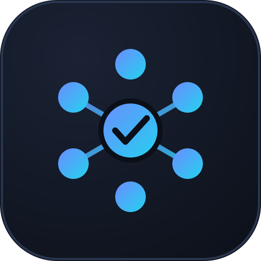
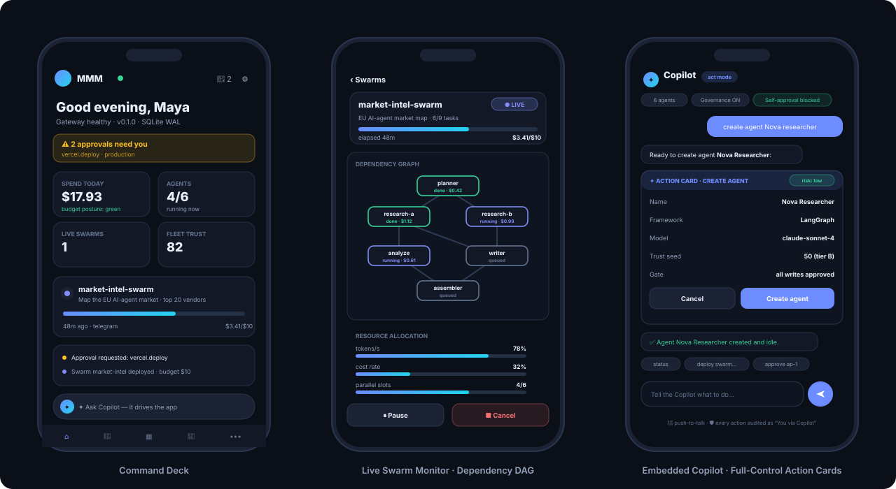
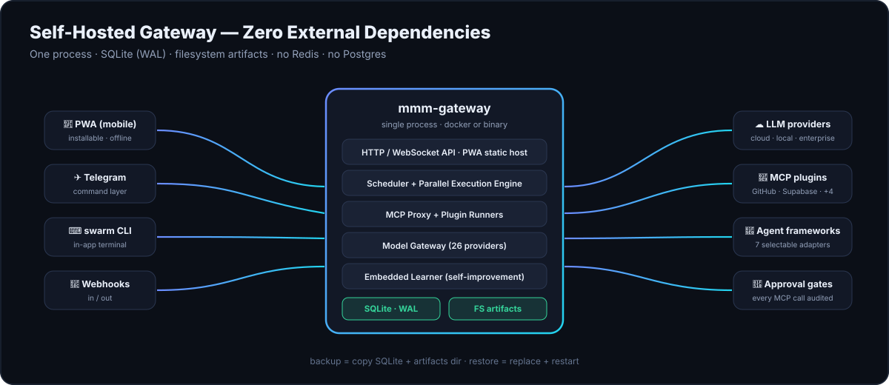

<div align="center">



# ⬡ SwarmOS

### 📱 Mobile-First AI Agent Orchestration Dashboard

**Build, deploy & govern AI agent teams and swarms — from your phone.**


[🎯 System](#-system-specification) · [📸 Screens](#-screens) · [📖 User Guide](#-user-guide) · [🚀 Deploy](#-run--deploy) · [📚 Docs](#-documentation)

</div>

---


## 🎯 System Specification

**SwarmOS** is a self-hosted, mobile-first control plane for AI agent operations: create agent profiles, compose teams, deploy swarms, and govern everything through a four-layer security framework — all from an installable Progressive Web App with an embedded full-control Copilot.

| | Spec | Detail |
| :---: | --- | --- |
| 📱 | **Interface** | Mobile-first PWA · 12 modules · dark/light themes · offline shell |
| 🤖 | **Agents** | 7 selectable frameworks: Swarmzero · AutoPentest · A.I.M.A · Project Nautilus · OpenAI Swarm · CrewAI · LangGraph |
| 🧠 | **Models** | 26 providers: OpenAI/Anthropic/Google/xAI · OpenRouter/Mistral/Cohere… · local Ollama/vLLM · DeepSeek/Groq… · Azure/Bedrock/Vertex/watsonx — **any model, per agent** |
| 🐝 | **Swarms** | Parallel execution engine · dependency DAGs · resource allocation · budgets |
| ⚡ | **OpenClaw** | Skills system · MCP tool integrations · multi-model routing · Telegram command layer |
| 🧬 | **Self-improvement** | Agents synthesize skills, refine prompts, optimize tool usage (ML) — always human-gated |
| 🔐 | **Governance** | Identity → Runtime isolation → MCP audit → Approval gates · per-agent trust scores (A/B/C) |
| 🧩 | **Plugins** | MCP: GitHub · Supabase · Firecrawl · Vercel · Airtable · Base44 + custom servers |
| 🗄 | **Backend** | Self-hosted gateway · **SQLite (WAL)** · zero external dependencies (no Redis/Postgres) |
| 🔑 | **Access** | Session login (scrypt + HttpOnly cookie + CSRF) · scoped API tokens · RBAC **Owner / Admin / Operator / Reviewer / Observer** · lockout · every mutation and denial audited |
| ✦ | **Copilot** | Central launcher + floating panel · 7 modes · grounded, source-linked answers · risk-classed confirm cards · browser-scoped memory · honest capability report |

---

## 📸 Screens

<div align="center">



*Command Deck · Live Swarm Monitor (dependency DAG + resource lanes) · Copilot action cards*

</div>

<details><summary>🏗 Architecture</summary><br/>

</details>

---

## ✨ The Modules

**🧭 Agent Designer** — guided creation: goal → dependency map → per-component configuration → dual validation → idle definition. [Design notes](docs/copilot/agent-designer.md).

| | Module | | Module |
| :---: | --- | :---: | --- |
| 🤖 | **Agent Manager** — profiles, brain, memory, trust | 🐝 | **Teams & Swarms** — topologies, deploy, live DAG |
| 📋 | **Kanban Board** — drag & drop, @agent dispatch | ⚡ | **Skills Hub** — 24-skill marketplace, multi-format import, [Skills Matrix](docs/copilot/skills-hub.md) |
| 🧠 | **Model Gateway** — routing, budgets, key vault | 🧩 | **Plugins** — MCP install & scoped grants |
| 💬 | **Chat** — streaming, inline approvals | 📡 | **Comms** — Telegram · WhatsApp · Discord · Slack · SMS · Browser gateways |
| 📊 | **Analytics** — KPIs, spend, trust posture | ⚙️ | **Settings** — everything live-tunable |
| 🧠 | **Local** — on-device AI preflight (nothing installed yet) | 🧭 | **Agent Designer** — guided creation, idle definitions |
| 📁 | **Artifacts & Files** — previews, upload, share | 💻 | **Terminal** — working `swarm` CLI |

---

## 📖 User Guide

### 🔑 Sign in (gateway mode)
```bash
npm install
npm run dev:gateway     # first start prints a generated Owner password once
npm run dev             # PWA on :5173, /api and /ws proxied to :8787
```
Open the app → **Account** (top-right chip) → *Configure gateway* → **Use this origin (dev proxy)** →
sign in. Set your own first Owner with `SWARMOS_BOOTSTRAP_EMAIL` / `SWARMOS_BOOTSTRAP_PASSWORD`
(see `.env.example`); production refuses to start without an owner.

Without a gateway the app stays in **demo mode** and says so — nothing is enforced. Signed-in
Copilot actions (create agent, create task, decide an approval gate) are authorised by the gateway
on every request, and the card reports the server's answer — including refusals.

**Where the data comes from.** Once signed in, agents, tasks, approvals and the event feed are read
from the gateway instead of the bundled fixtures. The top-bar chip shows `live` (WebSocket open) or
`synced` (HTTP only); every module header carries a `live gateway` / `demo data` tag, and the chip
opens a *Where this data comes from* sheet with the endpoint, the session, the last sync and a
per-slice table. If a refresh fails you get `stale gateway` plus a strip explaining that the rows
are the last server copy; if the gateway is unreachable the app falls back to demo fixtures and
labels them. Swarms, teams and usage still have no server store, so they are always marked demo.
Gateway rows are never written to `localStorage`, so a signed-out browser only ever holds fixtures.

### 🧭 Navigate
Bottom tabs: **Home · Agents · ✦ Copilot · Tasks · More** (all modules). **Chat** lives in the header, next to the notifications bell, so the bar keeps all four module slots. The **✦ Copilot** button is the centre action of the bottom navigation — tap it to open the floating panel; `Esc` closes it and your draft is kept.

### 🤖 Create an agent (60 seconds)
**Agents → ➕ New** → name & role → pick a **framework** → pick **any model** → bind tools → set governance → **Create**. Tap **▶ Run** to start it.

**Or design it properly:** **Agents → 🧭 Designer** (also in Quick create and All modules, and from
the New-agent sheet via *Open the Agent Designer instead*, which carries your input across). Describe
the goal → review the proposed components → configure each one → validate → save. Two honest limits
apply: the designer saves an **idle definition** (it cannot start an agent, because no runtime exists
in this repository), and capabilities that cannot work — voice, images, scheduled triggers — are
refused with the reason instead of appearing as toggles. See
[Agent Designer](docs/copilot/agent-designer.md).

### ⚡ Import a skill and see how skills connect
**Skills → ⤒ Import** (next to **New**) → paste a `SKILL.md`, a `skill.json`/`skill.yaml` manifest, a
registry index or a portable package, or upload a `.zip`/`.skill` bundle → **Analyse package**. The
review shows every skill, what it asks for, and what blocks it: embedded secrets, instruction-injection
text, unsafe archive paths and same-version duplicates are refused outright; missing dependencies,
version conflicts and external hosts are called out. Installed skills land **quarantined** (Skills →
Imported) and grant no tools or permissions — there is no skills runtime here, and the UI says so.
Click the **graph icon** beside Import, or the one in any skill drawer, to open the **Skills Matrix**:
typed edges (depends on, complements, conflicts with, …), an accessible table view, cycle-safe editing
with undo, and export. See [Skills Hub & Matrix](docs/copilot/skills-hub.md).

### 🐝 Deploy a swarm
**Teams & Swarms → Deploy** → write the objective → pick team + budget cap → **Deploy**. Open the swarm to watch the **live DAG** and resource bars.

### ✦ Drive it with the Copilot
Tap the centre **✦ Copilot** button and pick a mode — **Ask · Operate · Build · Knowledge · Training · Voice · Activity**:

| Say this | It does that |
| --- | --- |
| `status` | Live agent/swarm/approval counts, spend, gateway state |
| `explain this screen` | Describes the module you are on, with sources |
| `create agent Nova` | → review card → agent definition (status `idle`, not running) |
| `deploy swarm research` | → consequential plan card → **two-step** confirmation |
| `approve ap-1` | Prepares *your* decision; Copilot never decides or self-approves |
| `gateway authentication` | Knowledge hits with verification status + file paths |
| `can it sing?` | Reports the unsupported capability instead of faking output |

> 🛡 Every mutation is risk-classed (`reversible` / `consequential`), bound to the values shown, expires after 5 minutes, and is recorded in Copilot's episodic log with its evidence.

> 🔐 **Governance:** with a gateway session, agent/task writes and approval decisions are RBAC-checked server-side, separation-of-duties guarded (you cannot approve your own gate) and written to a hash-chained audit log. Read the contract in [`docs/copilot/copilot-governance-auth.md`](docs/copilot/copilot-governance-auth.md).

> ⚠️ **Truthfulness:** the module screens still read seeded demo state in the browser (read sync is pending). The panel header always shows `Demo data · gateway …`, and agents/swarms/training/voice actions say what is simulated. No model, scheduler, training worker, voice engine or SMS connector is called. See [`docs/copilot/PHASE0_DISCOVERY.md`](docs/copilot/PHASE0_DISCOVERY.md).

### ✈️ Control from Telegram
**Comms** → pick a gateway (Telegram, WhatsApp, Discord, Slack, SMS, Browser) → enter credentials →
**Send test**. A channel is *Configured · unverified* after saving and only becomes **verified** when
the provider accepts a real test; the Browser channel delivers into the in-app inbox with no
credentials at all. Each channel routes Copilot replies and chosen agents, and exposes a command
surface (`/status`, `/agents`, `/tasks`, `/ask`) with gated actions refused over channels. The
Copilot can drive it (`comms status`, `test telegram`, `route SRE-Bot to slack`, `mute discord`) but
never accepts secrets in chat. See [Comms gateways](docs/comms/channels.md) and
[credentials](docs/comms/credentials.md).

### 💻 Terminal
**Terminal** → try `help`, `status`, `agents`, `deploy audit plugins`, `approve ap-1`, `cat` a file. Destructive commands are policy-blocked.

### 📱 Install on your phone
Open the site → browser menu → **Add to Home Screen / Install App** (or **Settings → About → Install app**). Works offline; queued actions sync on reconnect.

---

## 🚀 Run & Deploy

### ▶ Run locally
```bash
git clone https://github.com/shawnthedon/MMM.git
cd MMM
npm install
npm run dev          # http://localhost:5173
```
Production build (real PWA — service worker active):
```bash
npm run build
npm run preview      # http://localhost:4173
```
Smoke-test everything: `npm run smoke`

### 🌍 Deploy to production (Vercel)
The app is a static Vite build — Vercel deploys it in one command:
```bash
npm i -g vercel
vercel login          # or set VERCEL_TOKEN
vercel --prod         # uses vercel.json → outputs the production URL
```
Or: push to GitHub → **vercel.com/new** → import `swarmos` → Framework: **Vite** → Deploy. *(PWA works out of the box: manifest + service worker included.)*

| Env | Command | URL |
| --- | --- | --- |
| 💻 Dev | `npm run dev` | localhost:5173 |
| 📦 Prod build | `npm run build && npm run preview` | localhost:4173 |
| ☁️ Production | `vercel --prod` | your Vercel URL |

---

## 🧪 Quality checks

```bash
npm test            # smoke 33 · copilot 6 · auth 16 · read sync 12 · designer 18 · skills 23 · comms 22 · responsive 17 · local 13 · kanban 26 · comms-gateway 27 · gateway 28
npm run smoke       # boots the real app — every route renders
npm run test:readsync  # gateway rows replace fixtures, provenance labels, no persistence
npm run test:designer  # designer shortcuts, validation split, definition save paths
npm run test:skills    # import formats + refusals, quarantine, matrix validation/undo, catalogue size
npm run test:comms     # channel status honesty, live-test outcomes, webhook signatures, routing, Copilot comms
npm run test:responsive # mobile-first CSS rules, tap targets, viewport meta, fluid controls
npm run test:local     # module-grid geometry + on-device AI preflight (capability probes, honest verdicts)
npm run test:kanban    # board zoom, wire geometry, confirm-then-move, Copilot board intents
npm run test:comms-gateway # server-side credentials, delivery outcomes, retry queue, webhook signatures
npm run test:gateway   # RBAC, CSRF, lockout, separation of duties, audit chain
npm run lint        # code style (after Phase-1 tooling)
```

---

## 📚 Documentation

| Document | What's inside |
| --- | --- |
| 📐 [Design Spec](docs/DESIGN_SPEC.md) | Full 12-module spec, governance, data model, providers |
| ✅ [Implementation Checklist](docs/IMPLEMENTATION_CHECKLIST.md) | Functional build: 19 phases, seed data & restore guide |
| 🗺 [Implementation Roadmap](docs/IMPLEMENTATION_ROADMAP.md) | Non-functional track to production + 100+ resource links |
| 🔄 [Read Sync](docs/copilot/read-sync.md) | How module screens read the gateway and how demo vs live data is labelled |
| 🧭 [Agent Designer](docs/copilot/agent-designer.md) | Guided agent creation: steps, validation states, honest boundaries, shortcuts |
| ⚡ [Skills Hub & Matrix](docs/copilot/skills-hub.md) | Import formats, scanning/quarantine rules, typed relationship matrix, export |
| 📡 [Comms gateways](docs/comms/channels.md) | Six channels, adapter contract, signature checks, status model |
| 🔐 [Comms server-side](docs/comms/server-side.md) | Encrypted credentials, comms routes, delivery outcomes, retry queue, webhooks, fan-out |
| 🔑 [Comms credentials](docs/comms/credentials.md) | Exactly what to supply per channel and where it is stored |
| 🗺 [Next up](docs/roadmap/next-up.md) | Open work with acceptance criteria (live comms, Local AI phases 2–6) |
| 🧱 [Kanban board](docs/kanban/board.md) | One write seam, zoom mechanics, dependency wires, move confirmation, Copilot intents, limits |
| 📱 [Mobile-first UI](docs/ui/responsive.md) | The responsive rules, breakpoints, touch targets — enforced by `test:responsive` |
| 🧠 [On-device AI audit](docs/local/on-device-audit.md) | Phase-1 audit for local GGUF models: platform findings, blockers, service boundary, phase gates |

---

<div align="center">
🛰️ Connect With Me
<div align="center">
<table bgcolor="#0d1117">
<tr>
<td align="center" width="300">
<br />
<b>Oluwaseun Lawal</b><br />
<i>Cyber Security Engineer</i><br /><br />
<a href="https://www.linkedin.com/in/oluwaseun-lawal">

</a>
<a href="mailto:cyberlawaltech@gmail.com">

</a>
<br /><br />
</td>
</tr>
</table>
</div>
  
**⭐ Star the repo** if you like orchestrating agents from anywhere!

⬡ Self-hosted · zero dependencies · MIT License · [Issues](../../issues)

</div>
