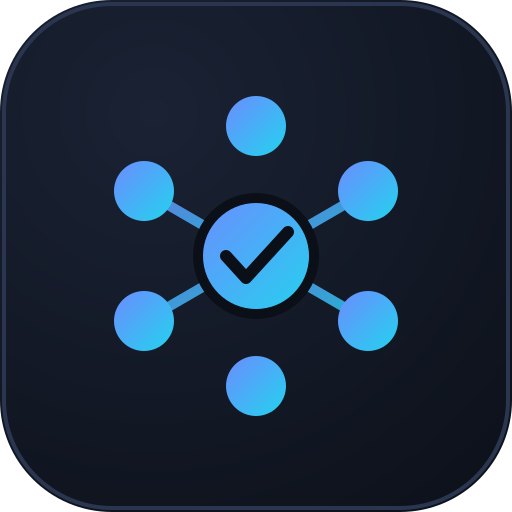
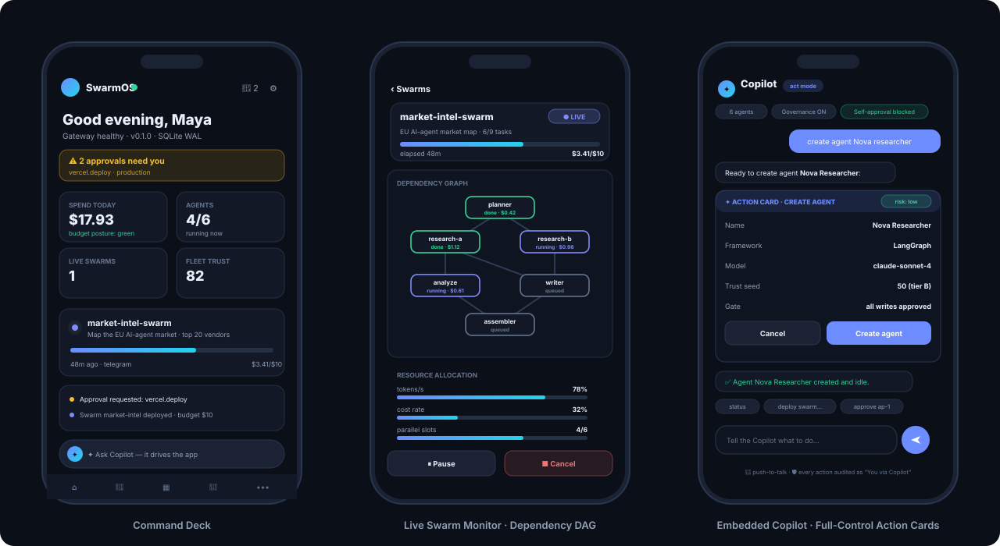
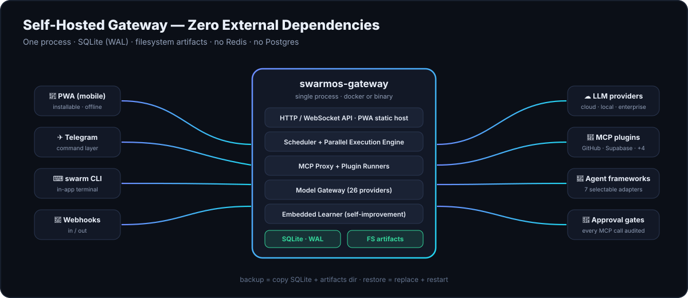

<div align="center">



# ⬡ SwarmOS

### 📱 Mobile-First AI Agent Orchestration Dashboard

**Build, deploy & govern AI agent teams and swarms — from your phone.**


[🎯 System](#-system-specification) · [📸 Screens](#-screens) · [📖 User Guide](#-user-guide) · [🚀 Deploy](#-run--deploy) · [📚 Docs](#-documentation)

</div>

---


## 🎯 System Specification

**SwarmOS** is a self-hosted, mobile-first control plane for AI agent operations: create agent profiles, compose teams, deploy swarms, and govern everything through a four-layer security framework — all from an installable Progressive Web App with an embedded full-control Copilot.

| | Spec | Detail |
| :---: | --- | --- |
| 📱 | **Interface** | Mobile-first PWA · 12 modules · dark/light themes · offline shell |
| 🤖 | **Agents** | 7 selectable frameworks: Swarmzero · AutoPentest · A.I.M.A · Project Nautilus · OpenAI Swarm · CrewAI · LangGraph |
| 🧠 | **Models** | 26 providers: OpenAI/Anthropic/Google/xAI · OpenRouter/Mistral/Cohere… · local Ollama/vLLM · DeepSeek/Groq… · Azure/Bedrock/Vertex/watsonx — **any model, per agent** |
| 🐝 | **Swarms** | Parallel execution engine · dependency DAGs · resource allocation · budgets |
| ⚡ | **OpenClaw** | Skills system · MCP tool integrations · multi-model routing · Telegram command layer |
| 🧬 | **Self-improvement** | Agents synthesize skills, refine prompts, optimize tool usage (ML) — always human-gated |
| 🔐 | **Governance** | Identity → Runtime isolation → MCP audit → Approval gates · per-agent trust scores (A/B/C) |
| 🧩 | **Plugins** | MCP: GitHub · Supabase · Firecrawl · Vercel · Airtable · Base44 + custom servers |
| 🗄 | **Backend** | Self-hosted gateway · **SQLite (WAL)** · zero external dependencies (no Redis/Postgres) |
| ✦ | **Copilot** | In-app operator with full app control — every action in a confirm card, self-approval blocked |

---

## 📸 Screens

<div align="center">



*Command Deck · Live Swarm Monitor (dependency DAG + resource lanes) · Copilot action cards*

</div>

<details><summary>🏗 Architecture</summary><br/>

</details>

---

## ✨ The 12 Modules

| | Module | | Module |
| :---: | --- | :---: | --- |
| 🤖 | **Agent Manager** — profiles, brain, memory, trust | 🐝 | **Teams & Swarms** — topologies, deploy, live DAG |
| 📋 | **Kanban Board** — drag & drop, @agent dispatch | ⚡ | **Skills Hub** — marketplace + synthesized review |
| 🧠 | **Model Gateway** — routing, budgets, key vault | 🧩 | **Plugins** — MCP install & scoped grants |
| 💬 | **Chat** — streaming, inline approvals | ✈️ | **Telegram Bridge** — command layer, signed buttons |
| 📊 | **Analytics** — KPIs, spend, trust posture | ⚙️ | **Settings** — everything live-tunable |
| 📁 | **Artifacts & Files** — previews, upload, share | 💻 | **Terminal** — working `swarm` CLI |

---

## 📖 User Guide

### 🧭 Navigate
Bottom tabs: **Home · Agents · Tasks · Chat · More** (all modules). Tap the **✦ dock** at the bottom to open the **Copilot** — it can drive the entire app.

### 🤖 Create an agent (60 seconds)
**Agents → ➕ New** → name & role → pick a **framework** → pick **any model** → bind tools → set governance → **Create**. Tap **▶ Run** to start it.

### 🐝 Deploy a swarm
**Teams & Swarms → Deploy** → write the objective → pick team + budget cap → **Deploy**. Open the swarm to watch the **live DAG** and resource bars.

### ✦ Drive it with the Copilot
Open the ✦ dock and try:

| Say this | It does that |
| --- | --- |
| `status` | Gateway + fleet summary |
| `create agent Nova` | → confirm card → agent created |
| `deploy swarm research` | → plan card → live swarm |
| `approve ap-1` | Releases a gate **on your instruction** |
| `open analytics` · `theme light` | Navigate / retheme |
| `analyze spend` | Cost report |

> 🛡 Every mutation shows an **action card** (risk, diff, gates) and is audited as *“You via Copilot”*. The copilot can never approve its own requests.

### ✈️ Control from Telegram
**Telegram Bridge** → link your bot → tap commands in the live preview (`/status`, `/budget`, `/ask researcher progress`). Approvals arrive with one-tap **signed** Allow/Deny buttons.

### 💻 Terminal
**Terminal** → try `help`, `status`, `agents`, `deploy audit plugins`, `approve ap-1`, `cat` a file. Destructive commands are policy-blocked.

### 📱 Install on your phone
Open the site → browser menu → **Add to Home Screen / Install App** (or **Settings → About → Install app**). Works offline; queued actions sync on reconnect.

---

## 🚀 Run & Deploy

### ▶ Run locally
```bash
git clone https://github.com/shawnthedon/MMM.git
cd MMM
npm install
npm run dev          # http://localhost:5173
```
Production build (real PWA — service worker active):
```bash
npm run build
npm run preview      # http://localhost:4173
```
Smoke-test everything: `npm run smoke`

### 🌍 Deploy to production (Vercel)
The app is a static Vite build — Vercel deploys it in one command:
```bash
npm i -g vercel
vercel login          # or set VERCEL_TOKEN
vercel --prod         # uses vercel.json → outputs the production URL
```
Or: push to GitHub → **vercel.com/new** → import `swarmos` → Framework: **Vite** → Deploy. *(PWA works out of the box: manifest + service worker included.)*

| Env | Command | URL |
| --- | --- | --- |
| 💻 Dev | `npm run dev` | localhost:5173 |
| 📦 Prod build | `npm run build && npm run preview` | localhost:4173 |
| ☁️ Production | `vercel --prod` | your Vercel URL |

---

## 🧪 Quality checks

```bash
npm run smoke   # boots the real app — all 12 modules render
npm run lint    # code style (after Phase-1 tooling)
```

---

## 📚 Documentation

| Document | What's inside |
| --- | --- |
| 📐 [Design Spec](docs/DESIGN_SPEC.md) | Full 12-module spec, governance, data model, providers |
| ✅ [Implementation Checklist](docs/IMPLEMENTATION_CHECKLIST.md) | Functional build: 19 phases, seed data & restore guide |
| 🗺 [Implementation Roadmap](docs/IMPLEMENTATION_ROADMAP.md) | Non-functional track to production + 100+ resource links |

---

<div align="center">
🛰️ Connect With Me
<div align="center">
<table bgcolor="#0d1117">
<tr>
<td align="center" width="300">
<br />
<b>Oluwaseun Lawal</b><br />
<i>Cyber Security Engineer</i><br /><br />
<a href="https://www.linkedin.com/in/oluwaseun-lawal">

</a>
<a href="mailto:cyberlawaltech@gmail.com">

</a>
<br /><br />
</td>
</tr>
</table>
</div>
  
**⭐ Star the repo** if you like orchestrating agents from anywhere!

⬡ Self-hosted · zero dependencies · MIT License · [Issues](../../issues)

</div>
